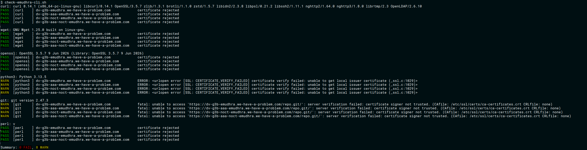

# eMudhra CA Trust Validation & Purge Checker

Tools and scripts (accompanied by Google Gemini) for validating system and Python TLS trust stores against the October 2026 eMudhra CA certificate debacle ([Mozilla Bug 2083449](https://bugzilla.mozilla.org/show_bug.cgi?id=2083449)).

I had several containers and systems to patch and trying to piece together a working fix from of all the discussion was a little tedious so wanted a way to actually verify things were mitigated. I also wanted a utility that could be adapted if more software turned up that was bundling it's own CA store.

For live test endpoints and real-time status details on affected intermediates, visit [emudhra.we-have-a-problem.com](https://emudhra.we-have-a-problem.com/). The URL for this site surfaced on the mozilla bugzilla blog noted above

I mainly focus on the system CA, curl, wget and python here. The URLs mentioned above should work for any any generic HTTPS tool you throw at it. It's understood that `apt` is using the system CA so I didn't bother with that.

---

## Script Overview

### 1. `check-emudhra-purge.py`
This was used to validate "purging" of problematic system and python CA stores on a vulnerable AWS docker image. AWS was not prioritizing the fixes so this was intended as a stopgap fix. It validates whether the local environment has successfully purged the compromised eMudhra / emSign / AAA root and intermediate certificates from Python's active `certifi` bundle and checks the pip version which was [updated manually](https://discuss.python.org/t/information-for-python-users-regarding-emudhra-emsign-ca-certificate-security-incident/109576/5). I wouldn't bother with this once AWS gets around to patching their lambda images. It's a hack for the interim, not a proper fix.

It checks:
* Minimum **`pip`** version threshold (`>= 26.2.2`).
* Minimum **`certifi`** version threshold (`>= 2026.10.19`).
* Absence of blacklisted strings (`eMudhra`, `emSign`, `AAA Certificate Services`) in the resolved CA bundle file (`certifi.where()`).

### 2. `check-emudhra.py`
Runs functional TLS handshake verification across standard Python HTTP libraries (`urllib` and `requests`), testing both default system CA stores and `certifi` bundles against eMudhra test hosts (`we-have-a-problem.com`).  This could be run on other python systems to test those stacks as well since a mitigated vuln will not allow a successful connecion to the URLs listed.
* **`PASS`**: Connection fails with a certificate verification error (expected secure behavior).
* **`FAIL`**: TLS handshake succeeds or returns an HTTP status code (compromised CA is still trusted).

### 3. `check-emudhra-cli.sh`
A lightweight Bash script performing HTTPS probes via `curl`, `wget`, `git` (and others) against the test domain endpoints. These test whatever these utils use for CA verification. Some utilities use the system CA store, others bundle their own (like Python).
* Returns exit code `0` (`PASS`) when `curl` rejects the certificate (exit code `60`). 
* Returns exit code `1` (`FAIL`) if TLS connection succeeds (it should not!).

---

## Debian Patching & System-Level Mitigation

### Why Vulnerable Version Numbers Might Pass Security Checks on Debian
Debian Linux (along with derivative distributions) backport patches/fixes without implementing the full upstream package. So, going solely by the installed package version won't always show that a system has been fully patched. This is where tests like the above come in especially handy.
